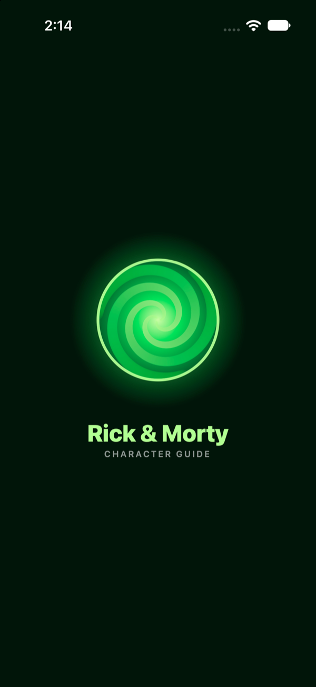
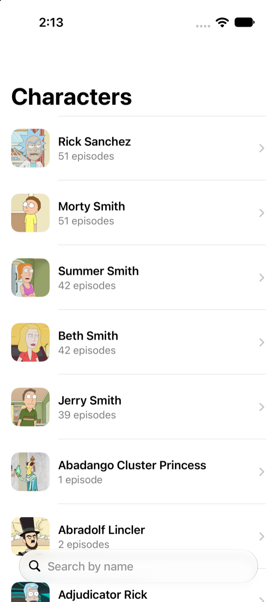
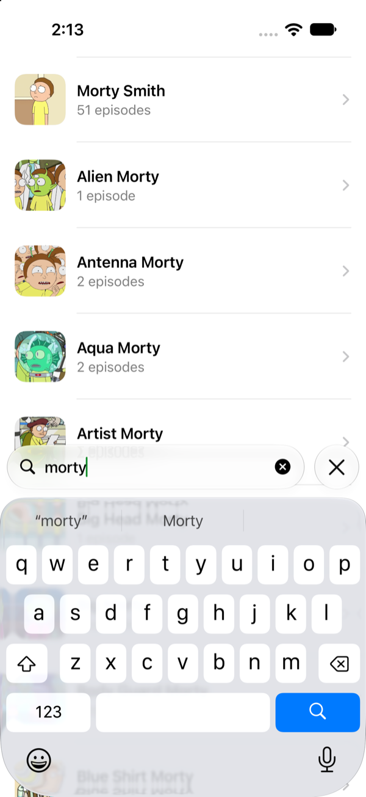
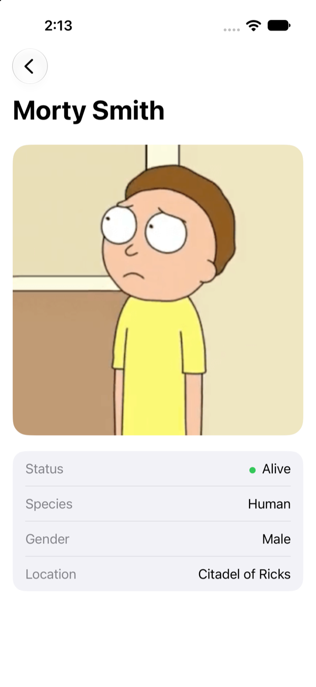

# Rick and Morty

SwiftUI app (iOS 17+) using the [Rick and Morty API](https://rickandmortyapi.com). No Combine. Kingfisher is the only dependency, used for image caching. The API calls are our own code.

## Features
- Character list (first page, 20 characters) with thumbnail, name and episode count
- Search by name with debounce
- Detail screen with image, name, status, species, gender and current location
- Episodes on the detail screen, grouped by season

## Screenshots
| Splash | List | Search | Detail |
| --- | --- | --- | --- |
|  |  |  |  |

App icon on the home screen:


## Structure
```
View -> ViewModel -> Repository -> Service -> URLSession
```
- `Core/Networking`: `ServiceEndPoint`, `ServiceProtocol`, `APIService`, `NetworkError`
- `Data`: `CharactersEndpoint`, response types (match the JSON) and `CharacterRepository`
- `Models`: `CharacterModel`, the type the UI uses. Response types are mapped to it with `toModel()`
- `Features`: list and detail screens
- `Shared`: image and small reusable views

There is no use case layer. The view model would only forward calls to the repository, so I left it out.

## Search
`.task(id: searchText)` restarts on every change and cancels the previous run. The view waits 400 ms, then calls the view model, all inside one `do/catch`. A cancel during the wait or during the request is dropped there.
A search with no matches returns 404 from the API, which the repository turns into an empty list.

## Episodes
The character response only has episode URLs, so the model keeps the ids and `EpisodeRepository` fetches them all in one request (`/episode/[1,2,3]`). The brackets matter: without them a single id returns an object instead of an array.
The detail screen has its own `CharacterDetailViewModel`. The character info shows right away, and the episodes load below it (spinner, list, or error with retry). The list screen gets a closure from the app entry point to create it, so the dependencies are wired in one place.

## Run
Open `RickAndMorty.xcodeproj`, choose an iPhone simulator and run. Tests: Cmd+U.
